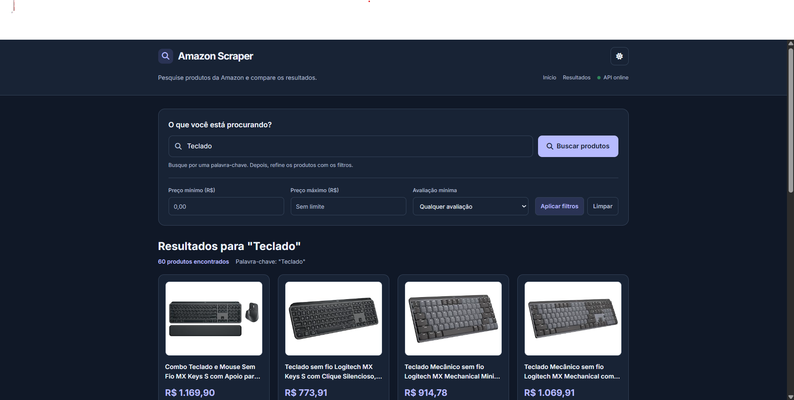
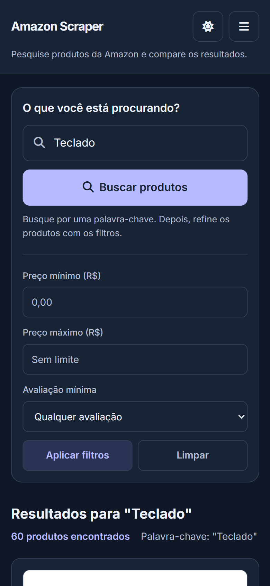

# Amazon Product Scraper

[]()
[]()
[]()
[]()
[]()
[]()

## About the project

**Amazon Product Scraper** is a full-stack Node.js application for querying, processing, and displaying products from Amazon Brazil. The solution combines structured scraping, a REST API, and a responsive web interface for searching and comparing products.

The project demonstrates HTML consumption and processing, data normalization, REST API development, caching, rate limiting, security headers, error handling, and interface development with HTML, CSS, JavaScript, Vite, and Tailwind CSS.

> The project depends on the HTML structure of an external service. Changes made by Amazon may require adjustments to the scraping process.

## Project architecture

```text
Frontend (Vite + Tailwind CSS)
        |
REST API (Node.js + Express)
        |
Axios
        |
JSDOM
        |
Data processing and normalization
        |
JSON response
```

The frontend consumes the API and displays products in a responsive grid. On the backend, Axios performs HTTP requests, JSDOM parses the HTML, and the collected data is normalized before being returned as JSON.

## Features

## Scraping and data

- Automated collection of products from Amazon Brazil;
- keyword search;
- HTML parsing with JSDOM;
- normalization of title, price, rating, reviews, image, and URL;
- results made available through a REST API in JSON format;
- in-memory cache with TTL.

## Interface

- Responsive layout for desktop and mobile;
- search with loading feedback;
- local filters for minimum price, maximum price, and minimum rating;
- consistent counter after filtering;
- progressive scrolling for card rendering;
- light/dark mode with persistence;
- manual retry to repeat the last attempted search;
- user-friendly handling of HTTP errors and external failures;
- discreet API status showing `API online` or `API unavailable`;
- footer with a dynamic year.

## Observability, performance, and security

- Health check endpoint;
- metrics endpoint maintained by the backend;
- rate limiting to mitigate abuse;
- security headers with Helmet;
- response compression;
- request logging;
- input parameter validation;
- centralized error handling.

## Endpoints

```http
GET /api
GET /api/health
GET /api/metrics
GET /api/scrape?keyword=product
```

The `keyword` parameter defines the term used to search for products.

## Interface

## Desktop



## Mobile



## Technologies

## Backend

- Node.js;
- Express;
- Axios;
- JSDOM;
- Helmet;
- Morgan;
- Compression;
- Express Rate Limit.

## Frontend

- Vite;
- Tailwind CSS;
- JavaScript;
- Vitest;
- JSDOM.

## How to run

## Prerequisites

- Git;
- Node.js `^20.19.0 || >=22.12.0`;
- npm.

## Clone the repository

```powershell
git clone https://github.com/NatanLuz/amazon_scraper_fullstackAPI.git
cd amazon_scraper_fullstackAPI
```

### Install the dependencies

From the root directory, install the backend and frontend dependencies reproducibly using the lockfiles:

```powershell
npm run install-all
```

To install them separately, use `npm run install-server` and `npm run install-client`.

### Run in development

In one terminal, start the backend:

```powershell
npm run dev
```

In another terminal, start the frontend:

```powershell
cd client
npm run dev
```

The interface will be available at:

```text
http://localhost:5173
```

The API will be available at:

```text
http://localhost:3000
```

### Run a production build

To build the frontend and serve it through the backend:

```powershell
npm run build
npm start
```

After the build, the application will be available at `http://localhost:3000`.

`npm run build:prod` reuses the build without installing dependencies. `npm run deploy` builds and starts the application locally; it does not publish it to an external platform.

## Tests

Run the backend tests:

```powershell
npm run test:backend
```

Run the frontend tests:

```powershell
cd client
npm test -- --run
```

Current validated status:

- backend: 9 tests;
- frontend: 14 tests;
- total: 23/23;
- client build: OK;
- root build: OK.

## Functional verification

After starting the backend and frontend:

1. Perform a keyword search;
2. check cards, images, prices, ratings, reviews, and links;
3. apply price and rating filters;
4. confirm the results counter;
5. test the manual retry after a simulated or actual failure;
6. confirm the `API online` or `API unavailable` status.

## Project structure

```text
amazon_scraper_fullstackAPI/
├── server/
├── client/
├── docs/
│   └── images/
├── package.json
├── README.md
└── ...
```

- `server/`: REST API, scraping, cache, metrics, and middleware;
- `client/`: web interface developed with Vite, Tailwind CSS, and JavaScript;
- `client/src/__tests__/`: automated tests run with Vitest;
- `docs/images/`: local screenshots used in the documentation;
- `package.json`: project dependencies and scripts;
- `README.md`: main technical documentation.

## Author

**Natan Da Luz**

- LinkedIn: [linkedin.com/in/natandaluz](https://www.linkedin.com/in/natandaluz/) 

- Portfolio: [portfolionatan.vercel.app](https://portfolionatan.vercel.app/)

- E-mail: [natandaluz01@gmail.com](mailto:natandaluz01@gmail.com)

## License

This project does not currently have a defined license.
